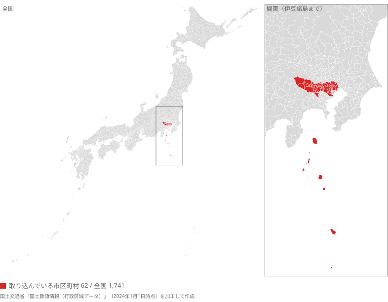

# seido

[](https://github.com/muroshima/seido-data/actions/workflows/ci.yml)
[](https://creativecommons.org/licenses/by/4.0/deed.ja)
[](LICENSE)

日本の支援制度（給付・助成・補助金・減免・貸付・現物支給）を、git の履歴として残すデータです。1 コミットは「1 つの取得元を 1 日見に行って見つかった変化」で、コミット日は観測日です。



赤が取り込んでいる市区町村です。詳しくは [registry/COVERAGE.md](registry/COVERAGE.md)。

```sh
git clone --filter=blob:none https://github.com/muroshima/seido-data
cd seido-data
git log --format='%ad %s' --date=short -- seido/13/132098   # 町田市の制度に起きた変化
git log -p -- seido/13/132098/machida-shogai-teate/20211116-tokuji-67bb17b1.md   # 1 制度の差分
```

自治体の制度ページは上書きで更新され、古い版は残りません。去年の所得制限がいくらだったか、いつ対象年齢が変わったかは、多くの場合あとから確かめられません。ここでは取得元を毎日見に行き、変化があればコミットします。

English summary is [below](#english).

## 収録範囲

2026-11-21 時点。

| | |
|---|---|
| 制度 | 8,439 件（東京都と都内 62 区市町村） |
| 取得元 | 131 件が取込中（[registry/sources.csv](registry/sources.csv)） |
| 観測の開始 | 2026-11-13（東京都の子育て支援制度レジストリだけは、更新が止まった 2025-08-20 の 1 コミット） |
| 国の府省庁 | まだ無い。脱炭素の補助事業などを調べている |

8,439 件のうち 6,205 件は、東京都の「子育て支援制度レジストリ」（0〜6 歳、CC BY）です。このデータは 2025-08-20 で更新が止まっているので、履歴は増えません。毎日変化を追っているのは、残りの約 2,200 件（自治体の標準オープンデータと、区市町村のサイトの制度ページ）です。

どの団体がどの取得元で取れているかは [registry/COVERAGE.md](registry/COVERAGE.md) にあります。東京から始め、関東、関西の順に広げます。

## 使い方

### 一覧から探す

[seido/index.csv](seido/index.csv) は制度 1 件 1 行の一覧です。列は [docs/schema.md](docs/schema.md#indexcsv) にあります。

```sh
curl -sL https://raw.githubusercontent.com/muroshima/seido-data/main/seido/index.csv -o index.csv
```

```python
import pandas as pd

df = pd.read_csv("index.csv", dtype={"lg_code": str})
df[(df.lg_name == "八王子市") & (df.support == "金銭")][["title", "url"]]
```

### 変化を追う

```sh
# この 1 週間に変わった制度（取得元ごと）
git log --since=2026-11-14 --format='%ad %s' --date=short -- seido

# 特定の取得元のコミットだけ
git log --format='%ad %s' --date=short --grep='^Source: hachioji-shogai-teate$'

# ある日の時点の 1 制度
git show "$(git rev-list -1 --before=2026-11-19T00:00:00+09:00 main)":seido/13/132098/machida-shogai-teate/20211116-tokuji-67bb17b1.md
```

`seido/index.csv` は 2026-11-21 から置いています。それより前の時点の一覧は、その時点の `seido/` を読んで作ってください（`git checkout <コミット> && uv run seido index`）。

`--filter=blob:none` で clone すると、最初は履歴だけを取り、ファイルの中身は必要になったときに取ります。全部取ると約 30 MB です。

## ファイルの構成

```
seido/index.csv                                        制度の一覧
seido/<都道府県コード2桁>/<団体コード6桁>/<source_id>/<ID>.md   制度 1 件
raw/<source_id>/<団体コード6桁>/<ID>.json                     取得元のレコード
registry/                                              団体と取得元の対応表
```

- `seido/` は読むためのファイルです。YAML frontmatter（制度名・団体・出典・ライセンスなど）と、概要・対象者・支援内容・利用方法・問い合わせなどの節からなります。
- `raw/` は取得元のレコードを加工せずに置いたものです。`seido/` は `raw/` から作り直せます。
- `<ID>` は取得元の ID 列があればそれ、無ければ制度ページの URL か制度名から作ります。
- 項目ごとの定義は [docs/schema.md](docs/schema.md) にあります。

## コミット

```
machida-shogai-teate: 10件更新（2026-11-20 観測）

Source: machida-shogai-teate
Source-Url: https://www.city.machida.tokyo.jp/iryo/syougai_hukushi/teatenenkin/index.html
Observed: 2026-11-20
Builder-Version: 0.1.0
```

- コミット日（author と committer）は観測日の 00:00 JST です。施行日ではありません。
- trailer は `git log --format='%(trailers:key=Source,valueonly)'` で取り出せます。
- `seido/index.csv` は、制度ファイルと同じコミットで更新します。どのコミットを取り出しても、一覧と制度ファイルが一致します。
- 取得元から消えた制度は、そのコミットでファイルが削除されます。
- 巡回の日に取り出せなかった制度の情報は、あとで別のコミット（trailer が `Observed` ではなく `Extracted`）で埋めます。書式は [docs/schema.md](docs/schema.md#コミット) にあります。
- `main` は force-push しません。コミットの SHA は変わりません。

## 制限

- **履歴は観測を始めた日（2026-11-13）からです。** それより前の改正は分かりません。
- **転載を禁止している取得元（1,737 件）は、本文を置いていません。** 制度名・URL・本文のハッシュと、ページから取り出した制度の情報（対象者・支援内容・期間・利用方法・問い合わせ）だけを、項目ごとに短く置いています。
- **その制度の情報は、ローカル LLM（Ollama の qwen3:8b）で取り出しています。** 誤りや取りこぼしがあります。項目が埋まっている割合は、対象者 89%、支援内容 87%、期間 71%、利用方法 79%、問い合わせ 86% です（2026-11-21、1,737 件）。原文と 30 文字以上続けて一致した項目は、書き写しとみなして空にします。
- **ページの本文が変わると、同じ内容でも言い回しの違う項目が出ることがあります。** LLM で取り出し直すためです。本文が同じなら前回の項目を引き継ぐので、本文が変わらない限り揺れません。
- **取得に失敗した取得元は、その回は 1 件も書き換えません。** 失敗を全件廃止と取り違えないためです。
- **`support`（金銭・現物）は取得元が区別しているときだけ入ります。** 2,234 件は空です。
- **ID 列の無い取得元は、制度名や URL から ID を作ります。** 名前や URL が変わると、削除と追加の 2 件に見えます。
- 内容の正確さは取得元に従います。申請の前には必ず `url` のページで確かめてください。

変更の記録は [CHANGELOG.md](CHANGELOG.md) にあります。取り出し方を直した日には、その取得元の多くのファイルが一度に変わります。

## 出典とライセンス

- 制度のデータ（`seido/`・`raw/`）の出典は、各ファイルの `attribution` にあります。再利用するときは、その出典も表示してください。
- 本文を置いているのは、CC BY・公共データ利用規約（PDL 1.0）・千代田区ホームページ利用規約の取得元だけです。
- このリポジトリが作ったデータ（`registry/`、`seido/` の構成、取り出した項目、`seido/index.csv`）: [CC BY 4.0](https://creativecommons.org/licenses/by/4.0/deed.ja)
- コード（`builder/`・`tests/`）: [MIT](LICENSE)
- 無保証です。このデータを使って生じた損害について、作者は責任を負いません。

引用するときは [CITATION.cff](CITATION.cff) を使ってください（GitHub の「Cite this repository」からも取れます）。

## 開発と貢献

取得元の追加の提案、取り出し方の誤りの報告は [Issue](https://github.com/muroshima/seido-data/issues) へどうぞ。手順は [CONTRIBUTING.md](CONTRIBUTING.md) にあります。

```sh
uv sync
uv run seido registry check                    # 対応表の検証
uv run seido update tokyo-ods-support-132101   # 1 つの取得元を取り込む
uv run seido index                             # 一覧を作り直す
uv run pytest
```

日次の取り込みは別の非公開リポジトリで動かし、`main` をこのリポジトリへ同期しています（自治体のサイトには海外の IP から繋がらないものがあるため、国内の自前の環境で巡回しています）。

## English

**seido** records Japanese public support programs (benefits, subsidies, grants, fee reductions, loans, in-kind support) as git history. Each commit is the change observed in one source on one day, and the commit date is the observation date (00:00 JST).

- `seido/index.csv`: one row per program (path, municipality code and name, title, monetary/in-kind, source, URL, license, attribution). See [docs/schema.md](docs/schema.md).
- `seido/<pref>/<municipality>/<source>/<id>.md`: one program, YAML frontmatter plus sections in Japanese.
- Coverage (2026-11-21): 8,439 programs in Tokyo and its 62 municipalities. History starts on 2026-11-13.
- For sources that forbid redistribution, only short facts extracted by a local LLM are kept, not the original text.
- Data: CC BY 4.0 (also credit the original source in `attribution`). Code: MIT. No warranty.
